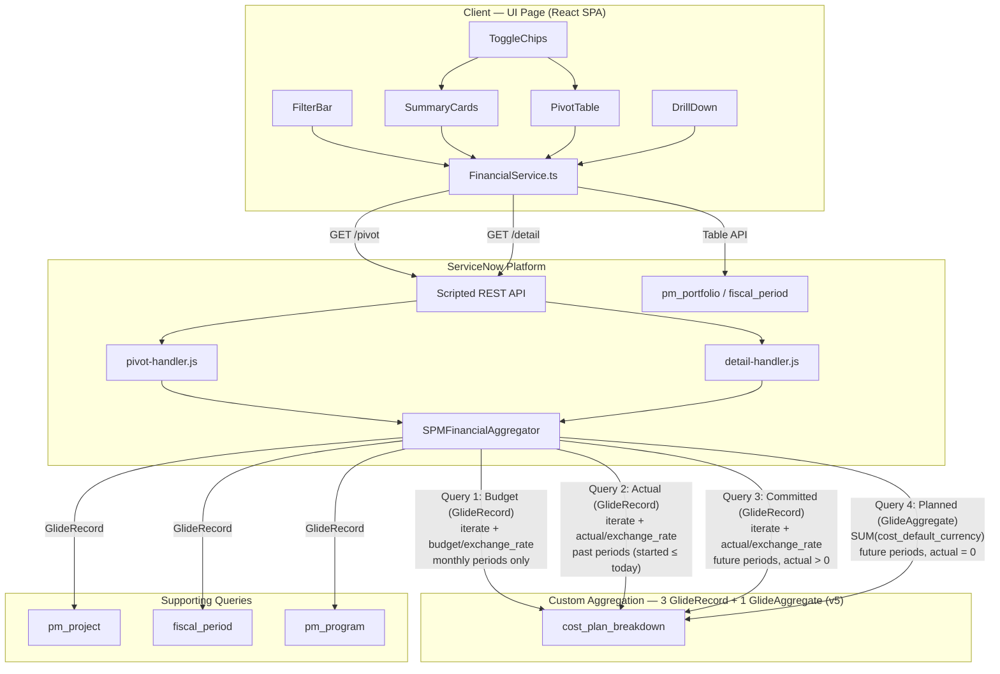
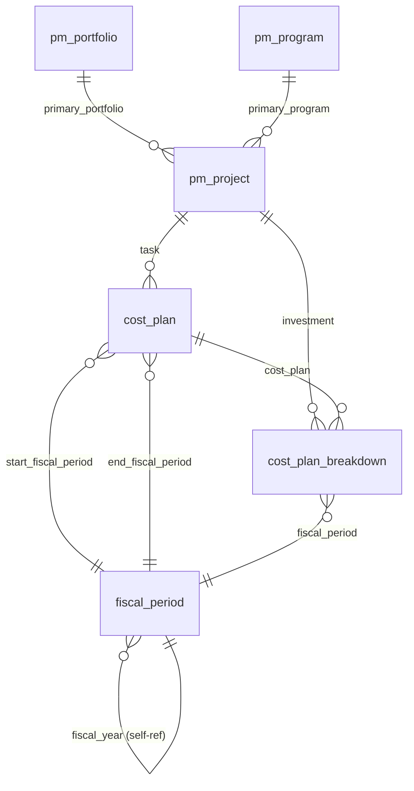

# SPM Financial Pivot Report — Design Document

> **App Name**: SPM Financial Report  
> **Scope**: `x_snc_spm_financia`  
> **Version**: 5.2 (Forecast with Conditional Color Coding)  
> **Last Updated**: June 2025

---

## 1. Overview & Purpose

The SPM Financial Pivot Report is a custom ServiceNow UI Page application that provides a navigable financial pivot view for Strategic Portfolio Management (SPM) projects. It fills a critical gap in the standard Financial Tab of the Strategic Planning Workspace by introducing **committed cost separation**, a **forecast calculation** (previsione di spesa totale nell'anno fiscale), and a **Total/OpEx/CapEx breakdown** for all metrics.

### Problem Statement

The out-of-box SPM financial views:
- Cannot distinguish between **past Actual Costs** and **future Committed Costs**
- Do not calculate a "true" forecast budget that accounts for costs already committed but not yet realized
- Offer limited customization of financial metrics and drill-down
- Do not provide a consolidated **OpEx vs CapEx** breakdown view per project

### Solution

A React-based Single Page Application served as a UI Page, backed by a custom Scripted REST API and server-side Script Include that performs **full custom aggregation** with per-record currency conversion (`/ exchange_rate`) and `groupBy('expense_type')` to produce Total/OpEx/CapEx breakdowns. The app presents:
- **Filters** — Portfolio (multi-select), Fiscal Year (multi-select)
- **Toggle Chips** — Show/hide Total, OpEx, CapEx column groups independently
- **5 KPI Summary Cards** — Budget, Planned, Actual, Committed, Forecast (one row per active category with colored badge)
- **Pivot Table** — One row per project with column groups per visible category (Total/OpEx/CapEx)
- **Drill-Down** — Expandable detail showing Cost Plans and Committed Lines

---

## 2. Architecture



### Layer Summary

| Layer | Technology | Responsibility |
|-------|-----------|----------------|
| **Frontend** | React 18 (UI Page) | Rendering, user interaction, client state, toggle visibility |
| **Styling** | CSS with `--now-*` design tokens | ServiceNow Horizon visual consistency |
| **Data Fetching** | Fetch API + X-UserToken | REST communication |
| **REST API** | Scripted REST (2 routes) | Parameter validation, response formatting |
| **Business Logic** | Script Include (SPMFinancialAggregator) | Full custom aggregation with currency conversion and expense_type grouping |
| **Custom Queries** | 3× GlideRecord + 1× GlideAggregate | Budget/Actual/Committed (per-record `/ exchange_rate`), Planned (SUM already in EUR) |

### v3 → v4 Architecture Change

In v3, we delegated Budget/Actual/Planned to `sn_invst_pln.FinancialsDataProviderImpl`. In v4, we moved to **full custom GlideAggregate** to support `groupBy('expense_type')` which the product API does not expose. This gives us per-project Total/OpEx/CapEx breakdowns.

### v4 → v5 Architecture Change

In v4, all 4 metrics used GlideAggregate with `SUM()`. In v5, we discovered that `actual` and `budget` fields are in **system currency (USD)**, not functional currency (EUR). Since GlideAggregate cannot perform per-record division, we switched Budget/Actual/Committed to **GlideRecord iteration** with `amount / exchange_rate` conversion. Only Planned remains as GlideAggregate because `cost_default_currency` is already in EUR.

---

## 3. Business Logic Definitions

All monetary values are converted to **EUR (€)** (functional currency). The `actual` and `budget` fields on `cost_plan_breakdown` are stored in system currency (USD) and must be divided by `exchange_rate` to get EUR.

### 3.1 The Five Metrics — Full Custom Approach

| Metric | Source | Formula | Notes |
|--------|--------|---------|-------|
| **Budget** | GlideRecord iteration | `Σ(budget / exchange_rate)` where `breakdown_type='task'`, monthly periods only (`fiscal_type='month'`) | Per-record conversion to EUR. Grouped by task + expense_type in-memory. |
| **Actual** | GlideRecord iteration | `Σ(actual / exchange_rate)` where `breakdown_type='task'`, past periods only (`fiscal_start_date_time <= today`) | Per-record conversion to EUR. Includes current month. |
| **Planned** | GlideAggregate | `SUM(cost_default_currency)` where `breakdown_type='task'`, future periods, `actual = 0` | Already in EUR — no conversion needed. Grouped by task + expense_type via groupBy. |
| **Committed** | GlideRecord iteration | `Σ(actual / exchange_rate)` where `breakdown_type='task'`, future periods, `actual > 0` | Per-record conversion to EUR. |
| **Forecast** | Calculated | `Planned + Actual + Committed` | Per category (total/opex/capex). Previsione di spesa totale nell'anno fiscale. Always >= 0. |

### 3.2 Key Business Rules

1. **Committed is NOT a subset of Actual in v4+** — Actual only counts past periods; Committed only counts future periods with actual > 0. Therefore `Forecast = Planned + Actual + Committed`.
2. **Planned captures future estimates** — future period breakdowns where actual is still 0 (not yet realized).
3. **Past period determination** — a period is "past" (and included in Actual calculation) if its `fiscal_start_date_time` field on `fiscal_period` is less than or equal to today's date. This means the **current month is included** in past periods (because its start date has already passed), ensuring actual costs for the current month are captured. A period is "future" if `fiscal_start_date_time > today`.
4. **breakdown_type = 'task'** — CRITICAL: All queries use `breakdown_type = 'task'` to avoid double-counting resource-level breakdowns.
5. **groupBy expense_type** — All queries group by both `task` AND `expense_type` (in-memory for GlideRecord, via `.groupBy()` for GlideAggregate), producing opex/capex buckets per project. Total = opex + capex.
6. **investment field** — The `task` field on `cost_plan_breakdown` references `pm_project` (since pm_project extends task). Used for grouping.
7. **Currency conversion** — All monetary amounts from `actual` and `budget` fields are converted to functional currency (EUR) by dividing by the `exchange_rate` field on `cost_plan_breakdown`. The helper `_convertToFunctional(amount, exchangeRate)` performs this: `exchangeRate !== 0 ? amount / exchangeRate : 0`.
8. **Month-level periods only** — Only periods with `fiscal_type='month'` are used for aggregation queries. Quarter-level and year-level rollup periods are excluded to prevent double-counting when `cost_plan_breakdown` contains records at multiple hierarchy levels.

### 3.3 Aggregation Algorithm (v5 — Currency Conversion & Period Hierarchy Fix)

```
1. Resolve project IDs from pm_project:
   - Filter: primary_portfolio IN portfolioIds
   - Filter: primary_program IN programIds (if provided)
   - Filter: active = true
   - Limit: 200
2. Resolve fiscal periods:
   a. Get child period IDs for selected fiscal years — ONLY month-level
      (fiscal_type='month'). Do NOT include year or quarter IDs.
      This returns exactly 12 period IDs per fiscal year.
   b. Determine which are "past" (fiscal_start_date_time <= today)
      ⚠️ This INCLUDES the current month (already started but not yet ended)
   c. Determine which are "future" (fiscal_start_date_time > today)
3. Run 3 GlideRecord iterations + 1 GlideAggregate on cost_plan_breakdown:
   
   Query 1 — BUDGET (GlideRecord):
     - investment IN projectIds
     - fiscal_period IN allMonthlyPeriodIds
     - breakdown_type = 'task'
     - For each record: sum += budget / exchange_rate
     - Group in-memory by (task, expense_type)
   
   Query 2 — ACTUAL (GlideRecord):
     - investment IN projectIds
     - fiscal_period IN pastPeriodIds
     - breakdown_type = 'task'
     - For each record: sum += actual / exchange_rate
     - Group in-memory by (task, expense_type)
   
   Query 3 — COMMITTED (GlideRecord):
     - investment IN projectIds
     - fiscal_period IN futurePeriodIds
     - breakdown_type = 'task'
     - actual > 0
     - For each record: sum += actual / exchange_rate
     - Group in-memory by (task, expense_type)
   
   Query 4 — PLANNED (GlideAggregate — cost_default_currency already in EUR):
     - investment IN projectIds
     - fiscal_period IN futurePeriodIds
     - breakdown_type = 'task'
     - actual = 0
     - GROUP BY task, expense_type → SUM(cost_default_currency)

4. Merge results per project:
   - For each (task, expense_type) pair → assign to opex or capex bucket
   - total = opex + capex for each metric
   - Calculate Forecast = Planned + Actual + Committed per bucket

5. Build response with total/opex/capex objects per project
6. Sum grand totals across all projects (per category)
```

### 3.4 Expense Type Distribution

Each query returns rows grouped by `(task, expense_type)`. The distribution logic:

```
For each row:
  if expense_type == 'opex' → add to project.opex[metric]
  if expense_type == 'capex' → add to project.capex[metric]
  
project.total[metric] = project.opex[metric] + project.capex[metric]
```

### 3.5 Currency Conversion Helper (v5)

```javascript
_convertToFunctional: function(amount, exchangeRate) {
    if (!exchangeRate || exchangeRate === 0) return 0;
    return amount / exchangeRate;
}
```

The `exchange_rate` field on `cost_plan_breakdown` represents the conversion factor from system currency (USD) to functional currency (EUR). Dividing the system-currency amount by this rate yields the functional-currency equivalent.

---

## 4. Data Model

### 4.1 Tables & Key Fields

| Table | Purpose | Key Fields |
|-------|---------|----------:|
| `pm_project` | Project records (pivot rows) | `sys_id`, `number`, `short_description`, `state`, `primary_portfolio`, `primary_program`, `active` |
| `pm_portfolio` | Portfolio filter source | `sys_id`, `name` (⚠️ NOT `short_description`) |
| `pm_program` | Program filter source | `sys_id`, `name`, `active` |
| `cost_plan` | Cost plan metadata (detail view) | `name`, `expense_type`, `cost_default_currency`, `task`, `start_fiscal_period`, `end_fiscal_period` |
| `cost_plan_breakdown` | **Primary aggregation source** | `investment`, `task`, `fiscal_period`, `budget`, `actual`, `cost_default_currency`, `expense_type`, `breakdown_type`, `exchange_rate` |
| `fiscal_period` | Fiscal calendar structure | `sys_id`, `name` (⚠️ NOT `label`), `fiscal_type`, `fiscal_year`, `fiscal_start_date_time`, `fiscal_end_date_time` |

### 4.2 pm_program Table (Server-Side Only)

The `pm_program` table is used server-side by the REST API when `program_ids` is passed. However, as of v4.1, the UI no longer includes a Program filter — the `program_ids` parameter is retained in the API for backward compatibility or direct API consumers only.

```
pm_program fields used (server-side only):
- sys_id: unique identifier
- name: display name
- active: filter for active=1 programs only
```

### 4.3 Relationships



### 4.4 Fiscal Period Hierarchy

```
fiscal_period (fiscal_type='year')     → "FY25"
  └─ fiscal_period (fiscal_type='quarter') → "Q1 FY25"
       └─ fiscal_period (fiscal_type='month')  → "January 2025"
```

> ⚠️ **v5 CRITICAL**: Only `fiscal_type='month'` periods are used in aggregation queries. Quarter and year-level periods are excluded to prevent double-counting from rollup records in `cost_plan_breakdown`.

---

## 5. REST API Endpoints

**Base URL**: `/api/x_snc_spm_financia/financial_report`

### 5.1 GET /pivot

Returns aggregated financial data with Total/OpEx/CapEx breakdown for all projects.

| Parameter | Required | Description |
|-----------|----------|-------------|
| `portfolio_id` | ✅ | Comma-separated portfolio sys_ids (max 10) |
| `fiscal_years` | ✅ | Comma-separated fiscal year sys_ids (max 5) |
| `program_ids` | ❌ | Comma-separated program sys_ids (max 10). Server-side only — UI no longer sends this parameter (removed in v4.1). |
| `project_state` | ❌ | Comma-separated state values |

> **Removed in v4**: `expense_type` parameter — data is now always returned with full Total/OpEx/CapEx breakdown.

**Response:**
```json
{
  "metadata": {
    "portfolioIds": ["abc123"],
    "fiscalYearIds": ["def456"],
    "programIds": ["ghi789"],
    "generatedAt": "2025-06-15T10:30:00Z"
  },
  "projects": [
    {
      "sys_id": "...",
      "number": "PRJ001",
      "short_description": "Project Alpha",
      "state": "execution",
      "total": { "budget": 100000, "planned": 20000, "actual": 50000, "committed": 10000, "forecast": 80000 },
      "opex": { "budget": 60000, "planned": 12000, "actual": 30000, "committed": 5000, "forecast": 47000 },
      "capex": { "budget": 40000, "planned": 8000, "actual": 20000, "committed": 5000, "forecast": 33000 }
    }
  ],
  "totals": {
    "total": { "budget": 100000, "planned": 20000, "actual": 50000, "committed": 10000, "forecast": 80000 },
    "opex": { "budget": 60000, "planned": 12000, "actual": 30000, "committed": 5000, "forecast": 47000 },
    "capex": { "budget": 40000, "planned": 8000, "actual": 20000, "committed": 5000, "forecast": 33000 }
  }
}
```

### 5.2 GET /detail

Returns cost plans and committed breakdown lines for a single project/FY.

| Parameter | Required | Description |
|-----------|----------|-------------|
| `project_id` | ✅ | sys_id of the project |
| `fiscal_year_id` | ✅ | sys_id of the fiscal year |

**Response:**
```json
{
  "cost_plans": [
    { "sys_id": "...", "name": "Labor - Internal", "type": "opex", "amount": 200000, "period": "January 2025 → December 2025" }
  ],
  "committed_lines": [
    { "sys_id": "...", "description": "opex", "amount": 50000, "period": "March 2025" }
  ]
}
```

> **v5 note**: The `amount` field in `committed_lines` is now converted to functional currency (EUR) using `actual / exchange_rate`.

---

## 6. UI Components

| Component | File | Responsibility |
|-----------|------|----------------|
| **FilterBar** | `FilterBar.tsx` | Portfolio multi-select, Fiscal Year multi-select, Apply button. Populates via Table API. |
| **ToggleChips** | Inline in `app.tsx` | 3 colored chips (Total/OpEx/CapEx) to toggle visibility of column groups. Built with native `<button>` elements using class `spm-toggle-chip`. Minimum 1 must remain active. |
| **SummaryCards** | `SummaryCards.tsx` | 5 colored accent cards showing one row per active category (each row has value + colored category badge). |
| **PivotTable** | `PivotTable.tsx` | Tabular view with column groups per visible category. Colored group headers. Expandable rows for drill-down. |
| **DrillDown** | `DrillDown.tsx` | Expanded detail view: Cost Plans table + Committed Lines table |
| **FinancialService** | `FinancialService.ts` | API client layer — all fetch calls with X-UserToken auth |
| **formatters** | `formatters.ts` | Currency formatting (EUR), number abbreviation. v5.2: `forecastClass(forecast, budget)` returns conditional CSS class for forecast vs budget comparison. |

### 6.1 FilterBar Behavior
- **Portfolio**: Multi-select, max 10 selections. Source: Table API `pm_portfolio?active=1`, display field: `name`
- **Fiscal Year**: Multi-select, max 5 selections. Source: Table API `fiscal_period?fiscal_type=year`, display field: `name`, ORDER BY DESC
- **Apply Button**: Disabled until at least one Portfolio AND one Fiscal Year are selected
- **No auto-load**: Data is NOT fetched on page mount. User must select filters and click "Apply Filters".

> **Removed in v4.1**: The Program multi-select filter has been removed from the UI. The REST API still accepts `program_ids` on the server side for backward compatibility, but the client no longer sends it.

### 6.2 ToggleChips Behavior (inline in app.tsx)
- Implemented inline in `app.tsx` using native `<button>` elements with class `spm-toggle-chip` (no separate component file)
- Appears AFTER data is loaded (not before first apply)
- 3 chips with distinct colors:
  - **Total** — Blue (`#2196F3`)
  - **OpEx** — Orange (`#FF9800`)
  - **CapEx** — Green (`#4CAF50`)
- Each chip is independently toggleable (on/off)
- **Constraint**: Minimum 1 chip must remain active. If user tries to deactivate the last active chip, it stays active.
- Controls which column groups appear in PivotTable
- Controls which categories SummaryCards displays (all active categories shown)

### 6.3 SummaryCards Behavior
- Shows 5 KPI cards: Budget, Planned, Actual, Committed, Forecast
- Displays **one row per active category** based on toggle state:
  - If Total+OpEx+CapEx are all active → each card shows 3 rows (one value + badge per category)
  - If OpEx+CapEx active (Total hidden) → each card shows 2 rows
  - If only one category active → each card shows 1 row
- Each row includes a **colored category badge**:
  - **Total** — neutral gray badge
  - **OpEx** — blue badge
  - **CapEx** — green badge
- Badge + formatted value displayed side by side per row

### 6.4 PivotTable Behavior
- One row per project
- **Column groups** per visible category, each with a colored header row:
  - Total group (blue header) → Budget, Planned, Actual, Committed, Forecast
  - OpEx group (orange header) → Budget, Planned, Actual, Committed, Forecast
  - CapEx group (green header) → Budget, Planned, Actual, Committed, Forecast
- Only visible (toggled-on) categories show their column groups
- Totals row at the bottom with bold styling
- Click on row expands drill-down
- Horizontal scroll for wide tables

### 6.5 Forecast Conditional Color Coding (v5.2)

The Forecast metric uses conditional coloring to signal budget alignment:

| Condition | Color | CSS Class | Token | Meaning |
|-----------|-------|-----------|-------|---------|
| Forecast > Budget | Red (critical) | `.forecast-over-budget` | `--now-actionable--primary-negative--background-color` (228,35,56) | Overspend: predicted spend exceeds budget |
| Forecast < Budget | Yellow (warning) | `.forecast-under-budget` | `--now-color_alert--high-2` (196,115,0) | Under-utilization: may need re-planning |
| Forecast = Budget | Neutral (default) | — | `--now-color_text--primary` | On track: spending aligns with budget |

Implementation:
- `forecastClass(forecast, budget)` in `formatters.ts` returns the CSS class
- Applied in PivotTable (project rows + totals row) and SummaryCards (forecast card values)
- Comparison is per-category (total/opex/capex): each category's forecast is compared to its own budget

---

## 7. Technical Decisions & Trade-offs

| Decision | Rationale | Alternative Considered |
|----------|-----------|----------------------|
| **Full custom aggregation (not product API)** | Product API doesn't support `groupBy('expense_type')`. We need per-project opex/capex breakdown. | `sn_invst_pln.FinancialsDataProviderImpl` (v3 — no expense_type grouping) |
| **GlideRecord for Budget/Actual/Committed (not GlideAggregate)** | `exchange_rate` conversion requires per-record division (`amount / exchange_rate`). GlideAggregate can only SUM/AVG — cannot divide each row before summing. | GlideAggregate `SUM(actual)` (v4 — produced values in wrong currency) |
| **GlideAggregate for Planned only** | `cost_default_currency` is already in functional currency (EUR) — no per-record conversion needed. GlideAggregate is more performant for simple SUM. | GlideRecord (unnecessary overhead for a field already in EUR) |
| **Month-level periods only (fiscal_type='month')** | Prevents multi-counting from quarter/year rollup records in `cost_plan_breakdown`. A fiscal year has 12 months + 4 quarters + 1 year = 17 period records. Including all levels inflates budget. | All child periods including quarters (v4 — caused double-counting) |
| **fiscal_start_date_time <= today for past periods** | Includes the current month in actuals. The current month has already started (start_date in the past) but not yet ended (end_date in the future). Users expect to see current month's actual costs. | `fiscal_end_date_time <= today` (v4 — excluded current month, showing €0 gap) |
| **`_convertToFunctional(amount, exchangeRate)` helper** | Centralizes the division logic with a zero-check to avoid division-by-zero errors. | Inline division in each query loop (error-prone, repetitive) |
| **4 separate queries (3 GlideRecord + 1 GlideAggregate)** | Each metric has different period/filter requirements (all periods for budget, past for actual, future+actual>0 for committed, future+actual=0 for planned). Clean separation. | Single query with post-processing (complex, error-prone) |
| **groupBy task + expense_type** | Produces (project, expense_type) pairs that directly map to our total/opex/capex response structure | groupBy investment (doesn't give expense_type breakdown) |
| **Program filter via pm_project.primary_program** | Direct FK relationship, no junction table needed. Simple IN query on pm_project. Server-side only in v4.1 (UI filter removed). | Portfolio-level program filtering (doesn't exist) |
| **Removed expense_type URL parameter** | All data is always returned with full breakdown. Client-side toggle controls visibility. Reduces API complexity. | Keep as server-side filter (limits client flexibility) |
| **Client-side toggle (not server filter)** | Data is already fetched with all categories. Toggle is instant (no re-fetch). Better UX. | Server-side filtering per category (unnecessary network calls) |
| **Forecast = Planned + Actual + Committed** | In v5.1, Forecast represents total projected spend for the fiscal year. Always >= 0. v5.2 adds conditional color coding (forecast vs budget). | `Budget - Actual - Committed` (v4 — could be negative, required different conditional coloring) |
| **`breakdown_type = 'task'`** | Without it, resource-level breakdown records are double-counted. Critical alignment. | No filter (v2 — produced inflated numbers) |
| **SUM(cost_default_currency) for Planned** | The `actual` field is 0 for planned rows. The `cost_default_currency` holds the planned amount and is already in EUR. | `actual` field (always 0 for planned) |
| **Pre-resolve period IDs** | GlideAggregate in scoped apps doesn't reliably support dot-walks | Dot-walk approach caused 500 errors |
| **`queryParams.toString()`** | ServiceNow REST `request.queryParams` returns Java String arrays | Direct access caused type coercion failures |
| **`fiscal_start_date_time`** (not `start_date_time`) | Correct GlideDateTime field on fiscal_period | `start_date_time` has non-standard format |
| **`setLimit(200)` on projects** | Performance guard for large portfolios | No limit (risk of timeout on large datasets) |
| **No auto-load without filters** | Prevents expensive unscoped queries | Auto-loading all data on page mount |
| **Multi-select filters with max limits** | Prevents overly broad queries (Portfolio max 10, FY max 5) | Unlimited selections (performance risk) |

### 7.1 Why Move Away from Product API in v4?

In v3, we used `sn_invst_pln.FinancialsDataProviderImpl` for Budget/Actual/Planned. In v4, we need `groupBy('expense_type')` which the product API does not expose. The product aggregates by investment only, returning a single total per project without OpEx/CapEx breakdown.

**Trade-offs of full custom approach:**
| Aspect | v3 (Product-Aligned) | v4 (Full Custom) |
|--------|---------------------|-----------------|
| Expense type breakdown | ❌ Not available | ✅ Full opex/capex per project |
| Custom queries | 1 (Committed only) | 4 (all metrics) |
| Code maintenance | Lower (~40 lines) | Higher (~100 lines) |
| Fiscal calendar handling | Product handles all types | Manual date comparison |
| Platform upgrade benefit | Auto-improves | Must maintain manually |

The trade-off is worth it because expense-type breakdown is the core v4 feature requirement.

### 7.2 The breakdown_type = 'task' Fix

The `cost_plan_breakdown` table contains multiple breakdown types:
- `task` — task-level cost allocation (what we want)
- `resource` — per-resource cost allocation
- Others — various allocation perspectives

All queries MUST include `addQuery('breakdown_type', 'task')` to avoid inflated numbers.

### 7.3 Why GlideRecord Instead of GlideAggregate for Budget/Actual/Committed (v5)

The `actual` and `budget` fields on `cost_plan_breakdown` are stored in **system currency (USD)**, not in functional/display currency (EUR). To get the correct EUR values, each record must be individually divided by its `exchange_rate`:

```
EUR_value = USD_value / exchange_rate
```

GlideAggregate's `SUM()` operates at the database level and cannot perform per-row division before summing. Therefore we must iterate with GlideRecord and accumulate in-memory.

**Why Planned can still use GlideAggregate**: The `cost_default_currency` field is already stored in functional currency (EUR), so a simple `SUM(cost_default_currency)` produces the correct result without per-record conversion.

---

## 8. Security Model

### Role
- **`x_snc_spm_financia.viewer`** — Custom role granting access to the report

### ACLs
| ACL | Type | Operation | Roles |
|-----|------|-----------|-------|
| REST API endpoint | `rest_endpoint` | Execute | `x_snc_spm_financia.viewer` |
| UI Page | `ui_page` | Execute | `x_snc_spm_financia.viewer` |

### Authentication
- UI Page uses session-based authentication (g_ck token)
- REST API calls include `X-UserToken` header for CSRF protection
- Admin override is enabled on both ACLs

---

## 9. File Structure

```
src/
├── client/
│   ├── app.css, app.tsx (includes inline ToggleChips), index.html, main.tsx, tsconfig.json
│   ├── components/
│   │   ├── DrillDown.tsx + DrillDown.css
│   │   ├── FilterBar.tsx + FilterBar.css
│   │   ├── PivotTable.tsx + PivotTable.css
│   │   └── SummaryCards.tsx + SummaryCards.css
│   ├── services/
│   │   └── FinancialService.ts
│   └── utils/
│       ├── fields.ts
│       └── formatters.ts
├── fluent/
│   ├── rest-api/financial-report.now.ts
│   ├── script-includes/spm-financial-aggregator.now.ts
│   ├── security/security.now.ts
│   └── ui-pages/spm-financial-report.now.ts
└── server/
    ├── SPMFinancialAggregator.js        ← Full custom aggregation (v5: GlideRecord + exchange_rate conversion)
    ├── tsconfig.json
    ├── rest-handlers/
    │   ├── pivot-handler.js             ← Updated: program_ids param (server-side only, UI removed), no expense_type
    │   └── detail-handler.js            ← v5: committed_lines amount uses actual/exchange_rate
    └── types/
        └── x_snc_spm_financia.d.ts
docs/
├── DESIGN_DOCUMENT.md                   ← This file (v5.2)
└── PROMPT_LIBRARY_SPM_FINANCIAL_REPORT.md
```

---

## 10. Performance Considerations

| Optimization | Implementation |
|-------------|----------------|
| **3 focused GlideRecord queries + 1 GlideAggregate** | Each query has minimal conditions — no unnecessary data scanned |
| **GlideRecord for currency conversion** | Iterates at most ~12 records per project per FY (one per month). Acceptable trade-off for correctness. |
| **GlideAggregate for Planned** | Since `cost_default_currency` is already in EUR, we can leverage DB-level SUM for best performance on this metric |
| **Month-only period filtering** | Reduces the IN clause from 17 IDs to 12 IDs per year. Eliminates redundant quarter/year rollup records. |
| **breakdown_type filter** | Reduces rows scanned by eliminating non-task breakdown records |
| **Period pre-resolution** | One GlideRecord query gets all period IDs + past/future classification upfront |
| **Client-side toggle** | No re-fetch needed when toggling categories — all data already loaded |
| **setLimit(200) on projects** | Caps the investment scope to prevent timeout |
| **Multi-select max limits** | Portfolio(10), FY(5) — prevents overly broad queries |
| **No auto-load** | User must explicitly apply filters before any query executes |
| **In-memory grouping** | For GlideRecord queries, grouping by (task, expense_type) in a JS object is O(n) with negligible overhead for ~12 records/project/FY |

### Performance Comparison: v4 vs v5

| Aspect | v4 (4× GlideAggregate) | v5 (3× GlideRecord + 1× GlideAggregate) |
|--------|------------------------|------------------------------------------|
| DB round-trips | 6 (projects, periods, 4× aggregate) | 6 (projects, periods, 3× record, 1× aggregate) |
| Records processed | DB-level SUM (fast, but wrong currency) | In-memory iteration (~12 records/project/FY per query) |
| Currency correctness | ❌ System currency (USD) shown as EUR | ✅ Properly converted to functional (EUR) |
| Period correctness | ❌ Over-counts (year+quarter+month rollups) | ✅ Month-only (12 per year) |
| Current month | ❌ Gap (excluded from past and future) | ✅ Included in past periods |
| Typical iteration count | N/A | ~12 × numProjects per metric (acceptable) |

> **Trade-off**: GlideRecord iteration is slightly slower than GlideAggregate SUM, but the overhead is minimal because each project has at most 12 monthly breakdown records per fiscal year. For a typical query of 20 projects × 1 FY, this means ~240 records per metric — well within acceptable performance bounds.

### Performance Comparison: v3 vs v4

| Aspect | v3 (Product-Aligned) | v4 (Full Custom + Expense Breakdown) |
|--------|---------------------|--------------------------------------|
| GlideAggregate calls | 1 (Committed only) | 4 (Budget, Actual, Committed, Planned) |
| Product API calls | 1 (`FinancialsDataProviderImpl`) | 0 |
| Total DB round-trips | 4 (projects, fiscal range, product API, committed) | 6 (projects, periods, 4× aggregate) |
| Custom code lines | ~40 | ~100 |
| Expense type breakdown | ❌ Not possible | ✅ Full opex/capex per project |
| Client re-fetch on toggle | N/A (no toggle) | ❌ Not needed (client-side) |

---

## 11. Migration Notes

### v5.1 → v5.2 (Forecast Conditional Color Coding)

**New Features:**

| Area | v5.1 | v5.2 |
|------|------|------|
| Forecast coloring | No conditional coloring | `forecastClass(forecast, budget)` in `formatters.ts` — compares forecast vs budget |
| CSS classes | None | `.forecast-over-budget` (red/critical), `.forecast-under-budget` (yellow/warning) |
| Design tokens | — | `--now-actionable--primary-negative--background-color` (228,35,56), `--now-color_alert--high-2` (196,115,0) |
| Applied in | — | PivotTable (project rows + totals row) and SummaryCards (forecast card values) |
| Comparison scope | — | Per-category (total/opex/capex): each category's forecast compared to its own budget |

**No breaking changes to REST API structure.** The response still contains `total`/`opex`/`capex` objects per project, each with 5 metrics.

### v5 → v5.1 (Forecast replaces former 5th metric)

**Breaking Changes:**

| Area | v5 | v5.1 |
|------|----|------|
| 5th metric | `Budget - Actual - Committed` (remaining budget) | Forecast (`Planned + Actual + Committed`) |
| JSON field name | legacy field name | `"forecast"` |
| Semantic meaning | Budget remaining after actual & committed spend | Total projected spend for the fiscal year (previsione di spesa totale) |
| Value range | Could be negative (over-budget) | Always >= 0 |
| Conditional coloring | green positive / red negative | Removed in v5.1 (re-introduced differently in v5.2) |
| CSS classes | legacy classes | Removed in v5.1 (new classes in v5.2) |
| Private method | `_calculateResiduals` | `_calculateForecast` |

**No other breaking changes to REST API structure.** The response still contains `total`/`opex`/`capex` objects per project, each with 5 metrics.

### v4 → v5 (Currency Conversion, Current Month Fix & Period Hierarchy)

**Bug Fixes (no breaking API changes):**

| Bug | Root Cause | Fix |
|-----|-----------|-----|
| Actual = €0 for current month | `fiscal_end_date_time <= today` excludes current month | Changed to `fiscal_start_date_time <= today` (period already started = past) |
| Values in wrong currency (USD displayed as EUR) | `SUM(actual)` aggregates system currency directly | Switched to GlideRecord: `actual / exchange_rate` per record |
| Budget inflated (double-counting) | Period list included year + quarter + month IDs (17 per year) | Filter `fiscal_type='month'` — only 12 monthly periods per year |

**Internal Changes (v4 → v5):**
| Area | v4 | v5 |
|------|----|----|
| Budget/Actual/Committed approach | GlideAggregate `SUM()` | GlideRecord iteration with `/ exchange_rate` |
| Planned approach | GlideAggregate `SUM(cost_default_currency)` | Unchanged (already in EUR) |
| Period resolution | All child periods of fiscal year | Only `fiscal_type='month'` children |
| Past period definition | `fiscal_end_date_time <= today` | `fiscal_start_date_time <= today` |
| Currency handling | None (assumed EUR) | `_convertToFunctional(amount, exchangeRate)` |
| Detail committed_lines amount | `actual` (raw, USD) | `actual / exchange_rate` (EUR) |
| New helper methods | — | `_convertToFunctional`, updated `_getPeriodsForFiscalYears`, `_getPastPeriods` |

**No breaking changes to REST API response format.** Values in the response are now correct (EUR) instead of incorrect (USD masquerading as EUR).

### v3 → v4 (Expense-Type Aggregation)

#### Breaking Changes
- **REST API response format changed**: Flat metrics replaced by nested `total`/`opex`/`capex` objects per project
- **`expense_type` parameter removed** from GET /pivot
- **`program_ids` parameter added** to GET /pivot (optional)
- **Forecast formula changed**: `Planned + Actual + Committed` (was `Budget - Actual` in v3). Note: In v5.1, the 5th metric was changed from a "remaining budget" calculation to the current Forecast formula.

#### Internal Changes
| Area | v3 | v4 |
|------|----|-----|
| Budget/Actual/Planned source | `sn_invst_pln.FinancialsDataProviderImpl` | Custom GlideAggregate ×4 |
| Expense type handling | URL parameter filter | groupBy expense_type → response buckets |
| Response structure | Flat: `{ budget, planned, actual, committed, forecast }` | Nested: `{ total: {...}, opex: {...}, capex: {...} }` |
| Forecast formula | `Budget - Actual` | `Planned + Actual + Committed` (current formula since v5.1) |
| Program filter | ❌ Not available | ✅ `program_ids` param + pm_project.primary_program filter (server-side only; UI filter removed in v4.1) |
| UI toggle | ❌ Not available | ✅ ToggleChips component |
| Summary cards | Shows single total | Shows all active categories with colored badges (one row per category) |
| PivotTable columns | 5 flat columns | Column groups per visible category with colored headers |
| Dependencies | `sn_invst_pln` scope required | No external scope dependency |

#### New UI Components (v4)
- **ToggleChips** — Category visibility control, built inline in `app.tsx` using `<button>` elements with class `spm-toggle-chip` (no separate component file)

---

*Document version: 5.2 — Forecast with Conditional Color Coding*  
*App scope: x_snc_spm_financia*
