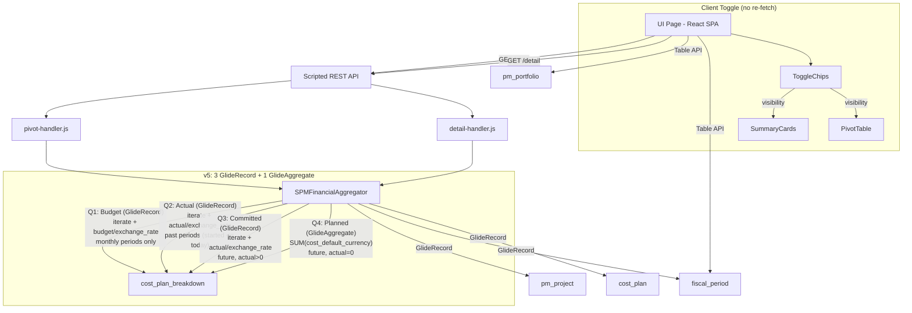
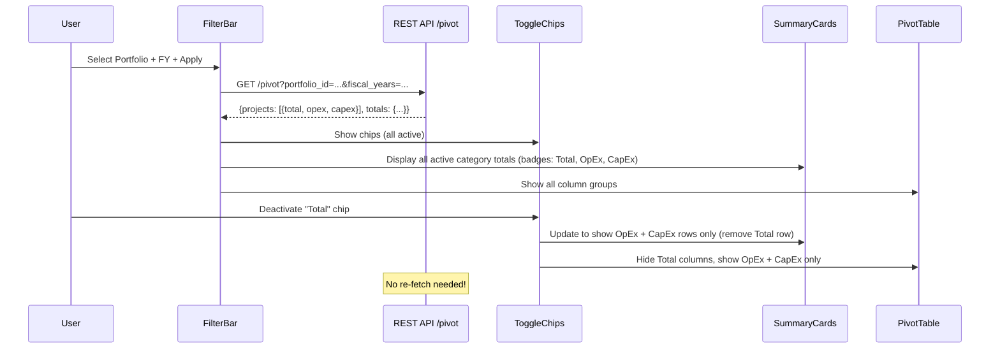

# Prompt Library — SPM Financial Pivot Report

> **Purpose**: A single, self-contained prompt that a colleague can copy-paste to recreate this entire application from scratch with all optimizations and pitfall solutions pre-applied.  
> **Version**: 5.2 — Forecast with Conditional Color Coding

---

## 📋 THE PROMPT

Copy the entire code block below into a new conversation:

````
Crea un'applicazione ServiceNow chiamata "SPM Financial Report" con scope "x_snc_spm_financia" che fornisce un report finanziario pivot per i progetti SPM (Strategic Portfolio Management) con breakdown Total/OpEx/CapEx.

## 1. Informazioni App

- **Nome**: SPM Financial Report
- **Scope**: x_snc_spm_financia
- **Descrizione**: Financial pivot report for SPM projects — provides Budget/Actual/Planned/Committed/Forecast metrics with full Total/OpEx/CapEx breakdown per project.
- **Currency**: EUR (€) — valuta funzionale. I campi `actual`/`budget` su cost_plan_breakdown sono in valuta SISTEMA (USD) e devono essere convertiti tramite `/ exchange_rate`.
- **Dipendenza**: Richiede il plugin ITBM/SPM attivo (tabelle `pm_project`, `pm_portfolio`, `pm_program`, `cost_plan_breakdown`, `fiscal_period`).

## 2. Architettura

L'app è composta da 4 layer:

1. **UI Page React SPA** — Dashboard con filtri (Portfolio, Fiscal Year), toggle chips (Total/OpEx/CapEx), summary cards, tabella pivot con column groups, e drill-down
2. **Scripted REST API** — Due endpoint: `GET /pivot` (aggregazione con breakdown) e `GET /detail` (drill-down)
3. **Script Include** — `SPMFinancialAggregator` — approccio FULL CUSTOM:
   - **3 GlideRecord iterations** (Budget, Actual, Committed) con conversione `/ exchange_rate` a valuta funzionale (EUR)
   - **1 GlideAggregate query** (Planned) con `SUM(cost_default_currency)` (già in EUR)
   - Tutti raggruppati per `task` + `expense_type`
   - Produce buckets total/opex/capex per ogni progetto
   - Helper `_convertToFunctional(amount, exchangeRate)` per la conversione valutaria
4. **Security** — Un ruolo custom (`x_snc_spm_financia.viewer`) + ACL su REST endpoint e UI Page

## 3. Business Logic — FULL CUSTOM (3 GlideRecord + 1 GlideAggregate)

### Perché NON usare FinancialsDataProviderImpl (v3)?

Il prodotto (`sn_invst_pln.FinancialsDataProviderImpl`) NON supporta `groupBy('expense_type')`. Aggrega solo per investment, producendo un singolo totale per progetto senza breakdown OpEx/CapEx. In v4 ci serve la breakdown, quindi usiamo query custom.

### Perché GlideRecord per Budget/Actual/Committed (v5)?

I campi `actual` e `budget` su `cost_plan_breakdown` sono in valuta SISTEMA (USD). Per ottenere la valuta funzionale (EUR) bisogna dividere ogni record per `exchange_rate`. Questa divisione per-record NON è possibile con GlideAggregate (che fa solo SUM/AVG/etc. lato DB). Per Planned si usa ancora GlideAggregate perché `cost_default_currency` è già in EUR e non serve conversione.

### Le 5 Metriche — Tutte Custom

| Metrica | Approccio | Condizioni | Campo / Formula | Conversione |
|---------|-----------|-----------|-----------------|-------------|
| **Budget** | GlideRecord | `breakdown_type='task'`, periodi MENSILI only (`fiscal_type='month'`) | `budget / exchange_rate` | Sistema→Funzionale (EUR) |
| **Actual** | GlideRecord | `breakdown_type='task'`, periodi PASSATI only (`fiscal_start_date_time <= today`) | `actual / exchange_rate` | Sistema→Funzionale (EUR) |
| **Committed** | GlideRecord | `breakdown_type='task'`, periodi FUTURI, `actual > 0` | `actual / exchange_rate` | Sistema→Funzionale (EUR) |
| **Planned** | GlideAggregate | `breakdown_type='task'`, periodi FUTURI, `actual = 0` | `SUM(cost_default_currency)` | Già in EUR (nessuna conversione) |
| **Forecast** | Calcolato | — | `Planned + Actual + Committed` | — |

**IMPORTANTE v5**: Il campo `actual` e `budget` su `cost_plan_breakdown` è in valuta SISTEMA (USD). Deve essere diviso per `exchange_rate` per ottenere la valuta funzionale (EUR). Il campo `cost_default_currency` è già in EUR. Per Budget/Actual/Committed si usa GlideRecord (iterazione per-record) perché serve la divisione per `exchange_rate`. Per Planned si usa ancora GlideAggregate (performance) perché `cost_default_currency` è già in EUR.

### Grouping Strategy

Per le 3 query GlideRecord, il raggruppamento è fatto in-memory:
```javascript
// Per ogni record iterato:
var task = gr.getValue('task');
var expenseType = gr.getValue('expense_type');
var amount = _convertToFunctional(parseFloat(gr.getValue('actual')), parseFloat(gr.getValue('exchange_rate')));
// → accumula in bucket[task][expenseType]
```

Per Planned (GlideAggregate):
```javascript
ga.groupBy('task');         // → per-project
ga.groupBy('expense_type'); // → opex/capex breakdown
```

Distribuzione:
- Se expense_type == 'opex' → project.opex[metric] += value
- Se expense_type == 'capex' → project.capex[metric] += value
- project.total[metric] = project.opex[metric] + project.capex[metric]

### Algoritmo di Aggregazione (Script Include):

```
1. Ottenere project IDs da pm_project:
   - Filtro: primary_portfolio IN portfolioIds
   - Filtro: primary_program IN programIds (se forniti)
   - Filtro: active = true
   - LIMIT 200

2. Risolvere periodi fiscali:
   a. Ottenere solo gli ID dei fiscal_period di tipo MESE (fiscal_type='month')
      figli dei fiscal year selezionati — NO quarter/year IDs per evitare
      double-counting da record rollup
   b. Classificare: PASSATI (fiscal_start_date_time <= today) vs FUTURI (> today)
      ⚠️ Nota: un periodo è "passato" se è già INIZIATO (non se è già finito).
      Questo include il mese corrente negli actual.

3. Eseguire 3 GlideRecord + 1 GlideAggregate su cost_plan_breakdown:

   Query 1 — BUDGET (GlideRecord con iterazione):
     gr.addQuery('investment', 'IN', projectIds)
     gr.addQuery('fiscal_period', 'IN', allMonthlyPeriodIds)
     gr.addQuery('breakdown_type', 'task')
     → Per ogni record: amount += budget / exchange_rate
     → Raggruppa in-memory per (task, expense_type)

   Query 2 — ACTUAL (GlideRecord con iterazione):
     gr.addQuery('investment', 'IN', projectIds)
     gr.addQuery('fiscal_period', 'IN', pastPeriodIds)
     gr.addQuery('breakdown_type', 'task')
     → Per ogni record: amount += actual / exchange_rate
     → Raggruppa in-memory per (task, expense_type)

   Query 3 — COMMITTED (GlideRecord con iterazione):
     gr.addQuery('investment', 'IN', projectIds)
     gr.addQuery('fiscal_period', 'IN', futurePeriodIds)
     gr.addQuery('breakdown_type', 'task')
     gr.addQuery('actual', '>', 0)
     → Per ogni record: amount += actual / exchange_rate
     → Raggruppa in-memory per (task, expense_type)

   Query 4 — PLANNED (GlideAggregate — cost_default_currency già in EUR):
     ga.addQuery('investment', 'IN', projectIds)
     ga.addQuery('fiscal_period', 'IN', futurePeriodIds)
     ga.addQuery('breakdown_type', 'task')
     ga.addQuery('actual', '=', 0)
     ga.groupBy('task'); ga.groupBy('expense_type')
     ga.addAggregate('SUM', 'cost_default_currency')

4. Merge risultati per progetto:
   Per ogni (task, expense_type, metric) → assegna a opex o capex bucket
   total = opex + capex per ogni metrica
   Calcola Forecast = Planned + Actual + Committed per bucket

5. Costruisci response con total/opex/capex objects per progetto
6. Somma grand totals cross-progetto (per categoria)
```

## 4. Tabelle e Campi — MAPPING ESATTO

⚠️ ATTENZIONE: Usa ESATTAMENTE questi nomi di campo.

| Tabella | Campo | Uso | Note Critiche |
|---------|-------|-----|---------------|
| `pm_portfolio` | `name` | Display del portfolio | ⚠️ NON `short_description` (è vuoto!) |
| `pm_program` | `name` | Display del programma | Filtro: `active=1` (server-side only, UI non lo usa in v4.1) |
| `pm_project` | `primary_portfolio` | Join portfolio→progetti | |
| `pm_project` | `primary_program` | Join program→progetti | Reference a `pm_program` |
| `pm_project` | `number`, `short_description`, `state`, `active` | Dati progetto | |
| `cost_plan` | `task` | Join con pm_project (nel detail) | Per il detail view |
| `cost_plan` | `name`, `expense_type`, `cost_default_currency` | Dati cost plan | |
| `cost_plan` | `start_fiscal_period`, `end_fiscal_period` | Reference a fiscal_period | Usa `getDisplayValue()` |
| `cost_plan_breakdown` | `investment` | Filtro per project scope | ⚠️ Usa `investment` per il filtro IN |
| `cost_plan_breakdown` | `task` | GroupBy per aggregazione | ⚠️ Usa `task` per groupBy (stessi sys_id) |
| `cost_plan_breakdown` | `breakdown_type` | Filtro CRITICO | ⚠️ DEVE essere `'task'` — senza questo i numeri sono gonfiati! |
| `cost_plan_breakdown` | `expense_type` | GroupBy per breakdown | Valori: 'opex', 'capex' |
| `cost_plan_breakdown` | `budget`, `actual`, `cost_default_currency` | Campi aggregazione | ⚠️ `actual`/`budget` in valuta sistema (USD)! Dividere per `exchange_rate` |
| `cost_plan_breakdown` | `exchange_rate` | Tasso di conversione sistema→funzionale | ⚠️ v5: usato per convertire actual/budget in EUR |
| `cost_plan_breakdown` | `fiscal_period` | Filtro per periodo | |
| `fiscal_period` | `name` | Display del periodo | ⚠️ NON `label` |
| `fiscal_period` | `fiscal_type` | Tipo (year/quarter/month) | Filtro dropdown: `fiscal_type=year`. Filtro aggregazione v5: `fiscal_type='month'` per evitare double-counting |
| `fiscal_period` | `fiscal_start_date_time` | Data inizio periodo | ⚠️ NON `start_date_time`. Usato per classificare passato/futuro |
| `fiscal_period` | `fiscal_end_date_time` | Data fine periodo | ⚠️ NON usare per classificare passato (escluderebbe mese corrente) |
| `fiscal_period` | `fiscal_year` | Self-reference al parent year | Per risolvere periodi figli |

## 5. Pitfall Tecnici CRITICI — SOLUZIONI OBBLIGATORIE

### 5.1 breakdown_type = 'task' (CRITICO)
`cost_plan_breakdown` contiene MULTIPLE breakdown types (task, resource, etc.). SENZA il filtro `breakdown_type = 'task'`, i valori aggregati sono GONFIATI (2x-3x il valore corretto).
- TUTTE le query DEVONO includere: `addQuery('breakdown_type', 'task')`

### 5.2 investment per filtro, task per groupBy
```javascript
// FILTRO — usa investment per scope:
gr.addQuery('investment', 'IN', projectIds.join(','));
// RAGGRUPPAMENTO — usa task per progetto (stessi sys_id):
// In-memory per GlideRecord, ga.groupBy('task') per GlideAggregate
```

### 5.3 queryParams.toString()
In ServiceNow Scripted REST API, `request.queryParams.xxx` restituisce un **Java String array**, NON una stringa:
```javascript
var portfolioId = request.queryParams.portfolio_id ? request.queryParams.portfolio_id.toString() : '';
```
Senza `.toString()` → errore 500.

### 5.4 NO Dot-Walk su GlideAggregate
GlideAggregate in scoped apps NON supporta dot-walk. Approccio corretto:
1. Risolvere TUTTI gli ID dei fiscal_period figli con GlideRecord
2. Classificarli in passati vs futuri
3. Usare `addQuery('fiscal_period', 'IN', periodIds.join(','))` direttamente

### 5.5 fiscal_start_date_time (NON start_date_time)
Il campo corretto per date su `fiscal_period` è `fiscal_start_date_time`. Il campo `start_date_time` ha formato non-ISO.

### 5.6 cost_default_currency (NON cost_local_currency)
Il campo `cost_local_currency` è sempre 0. Per Planned: `SUM(cost_default_currency)`.

### 5.7 NON auto-caricare dati senza filtri
La pagina NON deve fare fetch automatico al mount. L'utente DEVE cliccare "Apply Filters".

### 5.8 Period display per Cost Plans (DrillDown)
```javascript
period: cpGr.getDisplayValue('start_fiscal_period') + ' → ' + cpGr.getDisplayValue('end_fiscal_period')
```

### 5.9 Forecast = Planned + Actual + Committed (v5.1+)
In v5.1, Forecast replaced the former 5th metric. Actual = solo periodi passati. Committed = solo periodi futuri. NON si sovrappongono.
Formula corretta: `Forecast = Planned + Actual + Committed` (previsione di spesa totale nell'anno fiscale, sempre >= 0)

### 5.15 Forecast Conditional Color Coding (v5.2)
In v5.2, Forecast values are conditionally colored based on comparison to Budget:
- `forecastClass(forecast, budget)` in `formatters.ts` returns the CSS class
- Forecast > Budget → `.forecast-over-budget` (red/critical: `--now-actionable--primary-negative--background-color`, 228,35,56)
- Forecast < Budget → `.forecast-under-budget` (yellow/warning: `--now-color_alert--high-2`, 196,115,0)
- Forecast = Budget → no class (neutral: `--now-color_text--primary`)
- Applied in PivotTable (project rows + totals row) and SummaryCards (forecast card values)
- Comparison is per-category (total/opex/capex): each category's forecast is compared to its own budget

### 5.10 Planned usa cost_default_currency, NON actual
Per periodi futuri dove actual = 0, il valore pianificato è in `cost_default_currency`.
```javascript
// Query Planned (GlideAggregate — già in EUR):
ga.addQuery('actual', '=', 0);  // solo righe non ancora realizzate
ga.addAggregate('SUM', 'cost_default_currency');  // NON 'actual' (sarebbe 0!)
```

### 5.11 Toggle minimum 1 attivo
Il client DEVE impedire che tutti i toggle siano disattivati. Minimo 1 chip deve restare attivo.

### 5.12 Period Hierarchy — SOLO mesi (fiscal_type='month') (v5 CRITICO)
`fiscal_period` ha una gerarchia: year → quarter → month. Se `cost_plan_breakdown` ha record rollup a livello quarter/year, includere TUTTI i livelli nella query causa DOUBLE-COUNTING (es: un anno con 12 mesi + 4 quarter + 1 year = 17 periodi, budget gonfiato).
- `_getPeriodsForFiscalYears` DEVE filtrare `fiscal_type = 'month'` — restituisce solo i 12 periodi mensili per anno.
- NON includere l'ID del fiscal year stesso nella lista periodi.

### 5.13 Current Month Gap — fiscal_start_date_time <= today (v5 CRITICO)
Per classificare i periodi come "passati", usare `fiscal_start_date_time <= today` (il periodo è già INIZIATO).
- ⚠️ NON usare `fiscal_end_date_time <= today` — questo esclude il mese corrente! Se oggi è 15 giugno, il mese di giugno non è ancora "finito" ma i suoi actual DEVONO essere contati.
- Risultato con fix: il mese corrente è incluso nei periodi passati → actual del mese corrente appaiono nel report.

### 5.14 Currency Mismatch — actual/budget in valuta SISTEMA, NON funzionale (v5 CRITICO)
Il campo `actual` (e `budget`) su `cost_plan_breakdown` contiene valori in valuta SISTEMA (USD), NON in valuta funzionale (EUR).
- ⚠️ NON usare `SUM(actual)` direttamente — mostrerebbe USD come se fossero EUR!
- Fix: iterare con GlideRecord e calcolare `actual / exchange_rate` per ogni record.
- Il campo `exchange_rate` su cost_plan_breakdown contiene il tasso sistema→funzionale.
- Helper: `_convertToFunctional(amount, exchangeRate)` → `exchangeRate !== 0 ? amount / exchangeRate : 0`
- `cost_default_currency` è già in EUR — per Planned si può usare GlideAggregate direttamente.

## 6. REST API Endpoints

### GET /api/x_snc_spm_financia/financial_report/pivot
**Parametri**:
- `portfolio_id` (required, comma-separated, max 10)
- `fiscal_years` (required, comma-separated, max 5)
- `program_ids` (optional, comma-separated, max 10) — ⚠️ **Server-side only**: the UI no longer sends this parameter (removed in v4.1), but the API still accepts it for direct consumers.
- `project_state` (optional, comma-separated)

⚠️ **RIMOSSO in v4**: parametro `expense_type` — i dati vengono SEMPRE ritornati con breakdown completa.

**Response**:
```json
{
  "metadata": {
    "portfolioIds": ["abc123"],
    "fiscalYearIds": ["def456"],
    "programIds": ["ghi789"],
    "generatedAt": "2025-06-15T10:30:00Z"
  },
  "projects": [{
    "sys_id": "...",
    "number": "PRJ001",
    "short_description": "Project Alpha",
    "state": "execution",
    "total": { "budget": 100000, "planned": 20000, "actual": 50000, "committed": 10000, "forecast": 80000 },
    "opex": { "budget": 60000, "planned": 12000, "actual": 30000, "committed": 5000, "forecast": 47000 },
    "capex": { "budget": 40000, "planned": 8000, "actual": 20000, "committed": 5000, "forecast": 33000 }
  }],
  "totals": {
    "total": { "budget": 100000, "planned": 20000, "actual": 50000, "committed": 10000, "forecast": 80000 },
    "opex": { "budget": 60000, "planned": 12000, "actual": 30000, "committed": 5000, "forecast": 47000 },
    "capex": { "budget": 40000, "planned": 8000, "actual": 20000, "committed": 5000, "forecast": 33000 }
  }
}
```

### GET /api/x_snc_spm_financia/financial_report/detail
**Parametri**: `project_id` (required), `fiscal_year_id` (required)

**Response**: `{ cost_plans: [{sys_id, name, type, amount, period}], committed_lines: [{sys_id, description, amount, period}] }`

Il campo `period` nei cost_plans è: `getDisplayValue('start_fiscal_period') + ' → ' + getDisplayValue('end_fiscal_period')`
Il campo `period` nei committed_lines è: `getDisplayValue('fiscal_period')`
Il campo `description` nei committed_lines è: `getValue('expense_type') || 'Committed'`
Il campo `amount` nei committed_lines è: `actual / exchange_rate` (convertito a EUR, v5)

## 7. UI/UX Specifications

### Design System
- Usa ServiceNow **Horizon Design System** con token CSS `--now-*`
- Componenti da `@servicenow/react-components` (Select, Button) — MAI elementi HTML raw per form controls
- Fallback rgb su ogni variabile: `rgb(var(--now-actionable--primary--background-color, 0,128,163))`

### Header
- Gradient scuro: `linear-gradient(135deg, #1b2a4a 0%, #0d1b2a 100%)`
- Testo bianco, titolo con emoji 🏦

### FilterBar
- **Portfolio**: Multi-select, max 10. Source: Table API `pm_portfolio?active=1`, display: `name`
- **Fiscal Year**: Multi-select, max 5. Source: Table API `fiscal_period?fiscal_type=year`, display: `name`, ORDER BY DESC
- **Apply Button**: Disabilitato finché Portfolio AND Fiscal Year non hanno almeno 1 selezione
- ⚠️ **RIMOSSO in v4.1**: Il filtro Program multi-select è stato rimosso dalla UI. Il parametro API `program_ids` è mantenuto server-side per backward compatibility.
- ⚠️ **RIMOSSO**: Select Expense Type (non più necessario — breakdown sempre inclusa)

### ToggleChips (NUOVO in v4 — inline in app.tsx)
- Implementato inline in `app.tsx` con `<button>` nativi e classe `spm-toggle-chip` (nessun file componente separato)
- Appare SOLO dopo che i dati sono stati caricati (non prima del primo Apply)
- 3 chip colorati, toggleabili indipendentemente:
  - **Total** — Blu (`#2196F3`) — attivo di default
  - **OpEx** — Arancio (`#FF9800`) — attivo di default
  - **CapEx** — Verde (`#4CAF50`) — attivo di default
- **Vincolo**: Minimo 1 chip deve restare attivo. Se utente prova a disattivare l'ultimo, rimane attivo.
- Controlla quali column groups appaiono nella PivotTable
- Controlla quali categorie mostra SummaryCards (tutte le attive)

### Summary Cards (5 card colorate)
- Mostra **una riga per ogni categoria attiva** (non solo la prima):
  - Se Total+OpEx+CapEx attivi → ogni card mostra 3 righe (valore + badge colorato per categoria)
  - Se OpEx+CapEx attivi (Total nascosto) → ogni card mostra 2 righe
  - Se solo 1 categoria attiva → ogni card mostra 1 riga
- Ogni riga include un **badge colorato** per la categoria:
  - **Total** — badge grigio neutro
  - **OpEx** — badge blu
  - **CapEx** — badge verde
- Ogni card ha una barra laterale sinistra con gradient colorato:
  - Budget → Blu (`#2196F3` → `#1976D2`)
  - Planned → Verde (`#4CAF50` → `#388E3C`)
  - Actual → Arancio (`#FF9800` → `#F57C00`)
  - Committed → Rosso (`#f44336` → `#d32f2f`)
  - Forecast → Verde (`#4CAF50` → `#388E3C`)
- Numeri grandi: 26px, font-weight 800, font-variant-numeric: tabular-nums
- Background bianco con box-shadow sottile

### Forecast Conditional Color Coding (v5.2)

The Forecast metric uses conditional coloring to signal budget alignment:

| Condition | Color | CSS Class | Token | Meaning |
|-----------|-------|-----------|-------|---------|
| Forecast > Budget | Red (critical) | `.forecast-over-budget` | `--now-actionable--primary-negative--background-color` (228,35,56) | Overspend: predicted spend exceeds budget |
| Forecast < Budget | Yellow (warning) | `.forecast-under-budget` | `--now-color_alert--high-2` (196,115,0) | Under-utilization: may need re-planning |
| Forecast = Budget | Neutral (default) | — | `--now-color_text--primary` | On track: spending aligns with budget |

Implementation:
- `forecastClass(forecast, budget)` in `formatters.ts` returns the CSS class
- Applied in PivotTable (project rows + totals row) and SummaryCards (forecast card values)
- Comparison is per-category (total/opex/capex): each category's forecast is compared to its own budget

### Tabella Pivot (Column Groups)
- Riga header con **column groups colorati**:
  - Se Total visibile: header group blu con colonne Budget/Planned/Actual/Committed/Forecast
  - Se OpEx visibile: header group arancio con colonne Budget/Planned/Actual/Committed/Forecast
  - Se CapEx visibile: header group verde con colonne Budget/Planned/Actual/Committed/Forecast
- Prima colonne fisse: Project Number, Description, State
- Poi column groups per ogni categoria visibile
- Righe alternate (zebra striping)
- Hover highlight sulle righe
- Riga totali in fondo con font-weight bold e sfondo grigio chiaro
- Click su riga espande il drill-down
- Scroll orizzontale per tabelle larghe

### DrillDown (expandable sotto ogni riga progetto)
Due tabelle:

**Cost Plans:**
| Plan Name | Type | Amount | Start-End Period |
Dati da: `cost_plans[].name`, `cost_plans[].type`, `cost_plans[].amount` (formatted EUR), `cost_plans[].period`

**Committed Lines:**
| Description | Amount | Period |
Dati da: `committed_lines[].description`, `committed_lines[].amount` (formatted EUR, convertito via exchange_rate in v5), `committed_lines[].period`

## 8. Struttura File

```
src/
├── client/
│   ├── app.css                          — Stili globali (include stili .spm-toggle-chip)
│   ├── app.tsx                          — Root component React (include ToggleChips inline)
│   ├── index.html                       — HTML entry point
│   ├── main.tsx                         — React mount
│   ├── tsconfig.json                    — TypeScript config client
│   ├── components/
│   │   ├── DrillDown.tsx + DrillDown.css     — Dettaglio espandibile
│   │   ├── FilterBar.tsx + FilterBar.css     — Barra filtri (Portfolio, FY)
│   │   ├── PivotTable.tsx + PivotTable.css   — Tabella pivot con column groups
│   │   └── SummaryCards.tsx + SummaryCards.css — Card KPI con badge categoria (multi-row)
│   ├── services/
│   │   └── FinancialService.ts          — Client API layer (fetch + X-UserToken)
│   └── utils/
│       ├── fields.ts                    — Helper per display_value/value extraction
│       └── formatters.ts                — formatCurrency EUR. v5.2: `forecastClass(forecast, budget)` returns conditional CSS class (`.forecast-over-budget` / `.forecast-under-budget`) for forecast vs budget comparison.
├── fluent/
│   ├── rest-api/
│   │   └── financial-report.now.ts      — Definizione REST API + routes
│   ├── script-includes/
│   │   └── spm-financial-aggregator.now.ts — Definizione Script Include
│   ├── security/
│   │   └── security.now.ts             — Role + ACL definitions
│   └── ui-pages/
│       └── spm-financial-report.now.ts  — Definizione UI Page
└── server/
    ├── SPMFinancialAggregator.js        — Full custom: 3 GlideRecord + 1 GlideAggregate con exchange_rate conversion
    ├── tsconfig.json                    — TypeScript config server
    ├── rest-handlers/
    │   ├── pivot-handler.js             — Handler GET /pivot (v4: program_ids server-only, no expense_type)
    │   └── detail-handler.js            — Handler GET /detail (v5: committed lines con exchange_rate conversion)
    └── types/
        └── x_snc_spm_financia.d.ts      — Type declarations
docs/
├── DESIGN_DOCUMENT.md
└── PROMPT_LIBRARY_SPM_FINANCIAL_REPORT.md
```

## 9. Security

- **Ruolo**: `x_snc_spm_financia.viewer` — necessario per accedere a UI Page e REST API
- **ACL REST**: type `rest_endpoint`, operation `execute`, name `x_snc_spm_financia/financial_report`
- **ACL UI Page**: type `ui_page`, operation `execute`
- **Auth client**: header `X-UserToken: window.g_ck` su ogni fetch

## 10. Istruzioni Implementazione

1. Crea il Script Include `SPMFinancialAggregator` con la logica FULL CUSTOM:
   - Metodi pubblici: `getPivotData`, `getDetailData`
   - Metodi privati: `_getProjects`, `_resolveAndClassifyPeriods`, `_getPeriodsForFiscalYears`, `_getPastPeriods`, `_getFuturePeriods`, `_aggregateBudget`, `_aggregateActual`, `_aggregateCommitted`, `_aggregatePlanned`, `_convertToFunctional`, `_mergeResults`, `_calculateForecast`
2. `_getPeriodsForFiscalYears`: filtra `fiscal_type='month'` — restituisce SOLO periodi mensili (12 per anno)
3. `_getPastPeriods`: filtra `fiscal_start_date_time <= today` (include mese corrente!)
4. Budget: GlideRecord iteration, `budget / exchange_rate` su tutti i periodi mensili
5. Actual: GlideRecord iteration, `actual / exchange_rate` su periodi PASSATI
6. Committed: GlideRecord iteration, `actual / exchange_rate` su periodi FUTURI dove `actual > 0`
7. Planned: GlideAggregate `SUM(cost_default_currency)` su periodi FUTURI dove `actual = 0`
8. `_convertToFunctional(amount, exchangeRate)`: `return exchangeRate !== 0 ? amount / exchangeRate : 0;`
9. Merge: per ogni (task, expense_type) → distribuisci in opex/capex bucket, calcola total = sum
10. Crea i REST handlers (`pivot-handler.js`, `detail-handler.js`) — ricorda `.toString()` sui queryParams!
11. detail-handler: committed_lines amount usa `actual / exchange_rate` (v5)
12. pivot-handler: accetta `program_ids` (opzionale, server-side only — UI non lo invia), NON accetta `expense_type`
13. Crea la REST API Fluent definition con le due routes
14. Crea la UI Page React con tutti i componenti:
    - FilterBar: multi-select Portfolio, Fiscal Year + Apply (NO Program filter)
    - ToggleChips: 3 chip colorati post-load (inline in app.tsx con classe `spm-toggle-chip`)
    - SummaryCards: tutte le categorie attive con badge colorati (una riga per categoria per card)
    - PivotTable: column groups per categoria visibile + colored headers
    - DrillDown: invariato
15. Crea Security (role + ACL)
16. NON auto-caricare dati al mount.

## 11. Note Aggiuntive

- SDK: `@servicenow/sdk` versione 4.x con Fluent DSL
- UI usa `@servicenow/react-components` per Select e Button
- Tutti i file `.now.ts` vanno in `src/fluent/`
- Il client FinancialService usa `URLSearchParams` per costruire query strings
- I filtri sono popolati via Table API standard (`/api/now/table/...`) con `sysparm_display_value=all`
- ⚠️ **v4.1**: Il filtro Program NON è più presente nella UI — solo Portfolio e Fiscal Year
- Usa helper `displayValue(field)` e `sysIdValue(field)` per estrarre da oggetti `{value, display_value}`
- **NON richiede** più il scope `sn_invst_pln` (aggregazione fully custom in v4)
- Toggle state è gestito in React state (array di categorie visibili)
- La response API contiene SEMPRE total/opex/capex — il toggle è puramente client-side
- ⚠️ **v5**: Tutti i valori monetari in response sono in EUR (valuta funzionale) — la conversione da USD avviene server-side
````

---

## ⚠️ Errori Comuni (Riferimento Esterno)

Questa sezione è un riferimento per chi legge il prompt — NON è parte del prompt da copiare.

| # | Errore | Causa Root | Soluzione |
|---|--------|-----------|-----------|
| 1 | Numeri aggregati gonfiati (2x-3x) | Mancanza filtro `breakdown_type = 'task'` su cost_plan_breakdown | Aggiungere `addQuery('breakdown_type', 'task')` su TUTTE le query |
| 2 | Dropdown portfolio vuoti | Query usa `short_description` invece di `name` | Campo display è `pm_portfolio.name` |
| 3 | Dropdown fiscal year vuoti | Query usa `label` invece di `name` | Campo display è `fiscal_period.name` |
| 4 | 500 error su REST API | `request.queryParams.x` restituisce Java array | Aggiungi `.toString()` su ogni parametro |
| 5 | 500 su GlideAggregate con dot-walk | Dot-walk `fiscal_period.fiscal_year` in scoped app | Risolvi period IDs prima, poi query diretta con IN |
| 6 | Planned sempre = 0 | Usa campo `actual` (che è 0 per planned!) | Usa `SUM(cost_default_currency)` per Planned |
| 7 | Date comparison fallita | Usa `start_date_time` (formato non-ISO) | Usa `fiscal_start_date_time` (GlideDateTime) |
| 8 | 400 all'apertura pagina | Auto-load senza parametri obbligatori | Non fare auto-fetch; aspetta click su "Apply Filters" |
| 9 | Forecast errato | Formula `Budget - Actual` (v3) o `Budget - Actual - Committed` (v4) con nuova semantica | v5.1+: `Forecast = Planned + Actual + Committed` (previsione di spesa totale) |
| 10 | OpEx/CapEx mancanti nella response | groupBy solo per `task` senza `expense_type` | Aggiungere raggruppamento per `expense_type` su tutte le query |
| 11 | Period vuoto nel DrillDown | Usa `getValue()` su campo reference | Usa `getDisplayValue('start_fiscal_period')` |
| 12 | Toggle tutti disattivati | Nessun vincolo minimum | Impedire disattivazione ultimo chip attivo |
| 13 | Program filter non funziona | Usa campo sbagliato su pm_project | Il campo è `primary_program` (reference a `pm_program`). ⚠️ **Nota v4.1**: il filtro Program UI è stato rimosso; questo errore si applica solo al parametro server-side `program_ids`. |
| 14 | cost_local_currency = 0 | Campo sempre vuoto | Usa `cost_default_currency` |
| 15 | Budget gonfiato (double-counting periodi) | `_getPeriodsForFiscalYears` include year + quarter + month IDs (17 per anno) — record rollup a livello quarter/year vengono sommati | Filtrare `fiscal_type='month'` — restituisce solo 12 periodi mensili per anno. NON includere year/quarter IDs. |
| 16 | Actual = €0 per il mese corrente | `_getPastPeriods` usa `fiscal_end_date_time <= today` — il mese corrente non è ancora "finito" quindi non è "passato" | Usare `fiscal_start_date_time <= today` — un periodo è "passato" se è già INIZIATO (include mese corrente) |
| 17 | Valori in USD mostrati come EUR (importi sbagliati) | `SUM(actual)` via GlideAggregate — il campo `actual` è in valuta SISTEMA (USD), non funzionale (EUR) | Iterare con GlideRecord: `actual / exchange_rate` per ogni record. Il campo `exchange_rate` converte da sistema a funzionale. Solo `cost_default_currency` è già in EUR. |

---

## 🔄 Differenze v3 → v4

| Aspetto | v3 (Product-Aligned) | v4 (Expense-Type Aggregation) |
|---------|---------------------|-------------------------------|
| Fonte dati Budget/Actual/Planned | `sn_invst_pln.FinancialsDataProviderImpl` | 4 GlideAggregate custom |
| Expense type | Parametro URL filtro | groupBy → response buckets total/opex/capex |
| Response structure | Flat: `{budget, planned, actual, committed, forecast}` | Nested: `{total: {...}, opex: {...}, capex: {...}}` |
| Forecast formula | `Budget - Actual` (Committed ⊂ Actual) | `Planned + Actual + Committed` (current formula since v5.1) |
| Actual definition | All periods (from product) | Past periods only |
| Committed definition | Future periods with actual > 0 | Same (unchanged) |
| Planned source field | Product's planned_cost | `SUM(cost_default_currency)` where actual=0 |
| Filtro Expense Type | ✅ Dropdown nel FilterBar | ❌ Rimosso — toggle client-side |
| Filtro Program | ❌ Non disponibile | ✅ `program_ids` param server-side (UI filter removed in v4.1) |
| Toggle UI | ❌ Non presente | ✅ 3 chip colorati (Total/OpEx/CapEx) |
| SummaryCards | Totali singoli | Tutte le categorie attive con badge colorati (multi-row) |
| PivotTable | 5 colonne flat | Column groups per categoria + colored headers (Budget/Planned/Actual/Committed/Forecast per group) |
| Dipendenza sn_invst_pln | ✅ Richiesta | ❌ Non più necessaria |
| Complessità custom code | ~40 righe | ~100 righe |

---

## 🔄 Differenze v4 → v5

| Aspetto | v4/v4.1 | v5 (Currency Fix + Period Fix) |
|---------|---------|-------------------------------|
| Budget/Actual/Committed query | GlideAggregate `SUM(actual)` / `SUM(budget)` | GlideRecord iteration con `/ exchange_rate` |
| Planned query | GlideAggregate `SUM(cost_default_currency)` | Invariato (già in EUR) |
| Valuta dei campi actual/budget | Assunto EUR (errato — era USD sistema) | Riconosciuto come USD, convertito a EUR via `exchange_rate` |
| Helper conversione | Non presente | `_convertToFunctional(amount, exchangeRate)` |
| Periodi per aggregazione | Tutti i figli del fiscal year (year+quarter+month = 17 IDs) | Solo `fiscal_type='month'` (12 IDs per anno) |
| Classificazione "passato" | `fiscal_end_date_time <= today` (mese corrente escluso) | `fiscal_start_date_time <= today` (mese corrente incluso) |
| Actual del mese corrente | €0 (gap tra passato e futuro) | Correttamente incluso nei periodi passati |
| Detail committed_lines | `actual` diretto (USD) | `actual / exchange_rate` (EUR) |
| Performance | 4× GlideAggregate (veloce ma errato) | 3× GlideRecord + 1× GlideAggregate (corretto, ~12 records/progetto/FY) |
| Rischio double-counting | Presente con record rollup quarter/year | Eliminato con filtro month-only |

---

## 📐 Diagramma Architetturale



---

## 📌 Prerequisiti Istanza

- Plugin **IT Business Management** (SPM/ITBM) attivo (per le tabelle `pm_project`, `pm_portfolio`, `pm_program`, `cost_plan_breakdown`)
- Tabelle presenti: `pm_project`, `pm_portfolio`, `pm_program`, `cost_plan`, `cost_plan_breakdown`, `fiscal_period`
- Dati fiscali configurati (fiscal years + periods)
- SDK `@servicenow/sdk` versione 4.x

---

## 🎛️ Data Flow — Toggle Interaction


